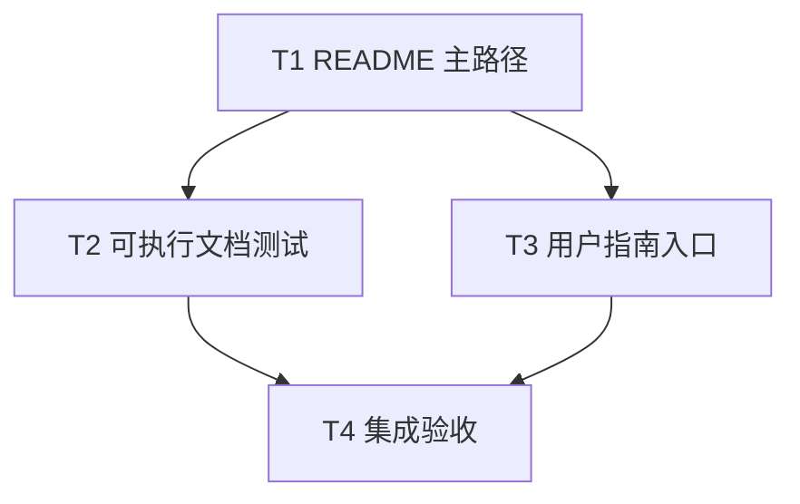

# README 安装路径与示例验证实施计划

> **面向执行者：** 按下面的任务依赖顺序实施，用复选框记录进度。用户已授权直接实施与本设计相关的修改；本计划本身不授权 `git add`、`git commit` 或 `git push`。

**目标：** 让 rs-validator 的中英文 README 快速开始只依赖本 crate、可被自身 CI 执行，并准确说明当前模型注解集成的本地路径依赖。

**依据：** [设计文档](design-20261013T073742703Z-c3fe85f1.md)。

**技术栈：** Rust 2024、Cargo、标准库集成测试、Markdown。

**工作目录：** `/data/working/qubit/rust-common/rs-validator`。在用户指定的当前 Paseo workspace 中工作，不创建或打开新的 Paseo workspace。

## 全局约束与文件映射

- 最低 Rust 版本为 1.94；快速开始只用 `qubit-validator = "0.1"` 与标准库。
- `qubit-model-metadata` 与 `qubit-model-derive` 在当前 checkout 均为 `publish = false`；本地路径示意必须标明布局，不暗示远端版本可直接安装。
- 用户注册场景的无效请求不写入，有效请求写入一次；检查 `is_truncated()` 后才能据 `is_valid()` 决定保存。
- 生产代码、API、原有测试、CI 框架和其他项目不在修改范围内；仅改下列四份既有文档并新增一份集成测试。
- `README.md`、`README.zh_CN.md`：安装、快速开始和模型集成说明；两版共享相同 Rust 示例语义。
- `doc/user_guide.md`、`doc/user_guide.zh_CN.md`：修正旧 README 注解示例的入口链接。
- `tests/documentation_examples_tests.rs`：提取并执行两版 README 示例，验证安装段与代码块的配对。

## 调度图

| 任务 | 前置任务 | 最小解锁产物 | 写入集合 | 本地验证 | 集成验证归属 | 审查时机 |
| --- | --- | --- | --- | --- | --- | --- |
| T1 README 主路径 | 无 | 两版 README 的成对标记、安装段和完整程序 | `README.md`、`README.zh_CN.md` | 手工核对两版标记、依赖、输出与链接 | T4 | 立即审查 |
| T2 可执行文档测试 | T1 | 两版 README 稳定 fenced block | `tests/documentation_examples_tests.rs` | `cargo test --test documentation_examples_tests --locked` | T4 | 立即审查 |
| T3 用户指南入口 | T1 | 新的模型集成节锚点 | `doc/user_guide.md`、`doc/user_guide.zh_CN.md` | 检查本地相对链接目标与标题 | T4 | 批量审查；可与 T2 并行 |
| T4 集成验收 | T2、T3 | 完整文档与测试 | 无源码写入 | `git diff --check` 与 `git status --short` | 本任务运行全量命令 | 立即审查 |

## 任务拓扑依赖图



### T1：重写两版 README 的首次运行路径

**文件：** `README.md`、`README.zh_CN.md`。

- [ ] 在 Installation/安装节保留单项 `qubit-validator = "0.1"`；在该 TOML 代码块前加入 `<!-- validator-quick-start:manifest -->`。移除这里的 `qubit-model-metadata`、`qubit-model-derive`、`qubit-reflect` 版本依赖。
- [ ] 在 Quick start/快速开始的 Rust 代码块前加入 `<!-- validator-quick-start:source -->`。用本 crate 的公开 API 写一个完整 `fn main() -> Result<(), Box<dyn Error>>`：定义 `NonBlank` 和 `AsciiEmail` 两个 `Validator<str>`、各自准备函数和静态描述符，注册稳定 ID `app.non_blank`、`app.email`，启动时绑定规则。对无效与有效的 `User` 分别按 `username`、`email` 两个路径调用 `BoundValidator::validate`、`ValidationReport::record_outcome`；应用在 `is_truncated()` 为 false 且 `is_valid()` 为 true 时才调用 `CountingRepository::insert`。程序用断言核对无效请求有两条代码为 `text.blank`、`text.email` 的违规、路径为 `username` 和 `email`、写入次数为 0，以及有效请求写入次数为 1。保留演示性质的 ASCII 邮箱形态说明，不宣称验证邮箱归属。
- [ ] 将原先有关 `#[Model]`、`ValidationPlan` 的解释移入简短的 `## Model annotations` / `## 模型注解集成` 节。说明对象遍历属于 `qubit-model-metadata`；写出布局 `<checkout>/rust-common/{rs-validator,rs-model-metadata,rs-reflect,rs-validation-rules}` 与 `<checkout>/app`，并给出从应用 `Cargo.toml` 计算的四个本地依赖路径：`../rust-common/rs-validator`、`../rust-common/rs-model-metadata`（`features = ["validation"]`）、`../rust-common/rs-model-metadata/derive`、`../rust-common/rs-reflect`。注明前两个模型 crate 在当前 checkout 为 `publish = false`；链接对应语言的模型校验用户指南。

  进阶路径的 TOML 示意应为：

  ```toml
  [dependencies]
  qubit-validator = { path = "../rust-common/rs-validator" }
  qubit-model-metadata = { path = "../rust-common/rs-model-metadata", features = ["validation"] }
  qubit-model-derive = { path = "../rust-common/rs-model-metadata/derive" }
  qubit-reflect = { path = "../rust-common/rs-reflect" }
  ```
- [ ] 分别审读两版文字：两版示例代码与安装项一致；中文表达自然；不把跨项目路径示意写成默认安装条件；文档中的运行命令与实际程序吻合。

### T2：让 README 程序进入自动测试

**文件：** 新建 `tests/documentation_examples_tests.rs`。

- [ ] 编写一个 `#[test]`，遍历 `README.md` 与 `README.zh_CN.md`。实现只接受唯一 `<!-- validator-quick-start:manifest -->` 与唯一 `<!-- validator-quick-start:source -->` 的提取函数；每个标记后首个 fenced block 必须分别为 `toml`、`rust`，否则失败。断言安装块恰为 `[dependencies]` 加 `qubit-validator = "0.1"`；不得默许额外依赖。为提取函数加入缺失标记、重复标记和错误代码块语言的单元用例，先让这些用例因函数尚未实现而失败，再实现提取逻辑使其通过。
- [ ] 对每版创建互不重叠的临时 Cargo 应用目录，写入提取的 Rust 内容为 `src/main.rs`。夹具 `Cargo.toml` 将 README 中的版本依赖替换为 `qubit-validator = { path = "/data/working/qubit/rust-common/rs-validator" }`；实现时用 `env!("CARGO_MANIFEST_DIR")` 取得该项目根目录，而非把机器路径硬编码进测试。该替换只发生在夹具，不能改 README。执行 `cargo run --offline --quiet`，失败时输出文档名、命令退出码与 stderr。临时目录只由创建它的测试清理，不能清理别的构建缓存。使用唯一目录名避免并行测试冲突；将嵌套 Cargo target 放到夹具自有目录，避免锁冲突。
- [ ] 再运行 `cargo test --test documentation_examples_tests --locked`，确认英文、中文程序均编译运行。提取函数的负向用例须证明删除标记或改坏安装项会失败，不直接改写 README 做故障注入。若 CI 证明 `--offline` 因 Cargo home 隔离不能解析已缓存依赖，仅把夹具命令改为共享同一 Cargo home 的在线 `cargo run --quiet`，并记录原因；新夹具尚无锁文件，不使用 `--locked`，也不得跳过任一语言。

### T3：修正用户指南的进阶入口

**文件：** `doc/user_guide.md`、`doc/user_guide.zh_CN.md`。

- [ ] 将两版指南中“README 的用户注册注解快速开始”相关文字与锚点改为新 README 的模型注解进阶节：英文使用 `../README.md#model-annotations`，中文使用 `../README.zh_CN.md#模型注解集成`。该节再链接对应语言的 `rs-model-metadata` 校验指南。保留指南现有的直接绑定、报告、依赖、参数和错误教程。
- [ ] 检查新增的 README 本地锚点和指南相对链接能定位到真实标题；两版语言对应同一能力与限制。

### T4：集成验收与范围复核

**写入集合：** 无；仅对 T1–T3 的结果做检查。

- [ ] 运行 `cargo test --test documentation_examples_tests --locked`，确认两版 README 示例通过。
- [ ] 顺序运行 `cargo test --no-default-features --locked` 与 `cargo test --all-features --locked`；确认全部测试及 doctest 通过。两次共享 `target`，不要并发运行。
- [ ] 运行项目格式检查 `.infra/bin/style-check.sh` 和 `cargo fmt --all -- --check`；如稳定版 rustfmt 仅提示配置项需要 nightly，记录提示并以项目检查的退出码为准，不因该提示改动无关格式。
- [ ] 检查 `README.md`、`README.zh_CN.md`、两版用户指南的相对链接和 `#` 标题锚点；核对两版安装项、行为、限制、路径示意及模型指南入口。
- [ ] 运行 `git diff --check`、`git diff --stat`、`git status --short`，确认只涉及本计划列明的文件及两份已授权的方案文档；报告实际命令结果与仍存在的限制。不执行 `git add`、`git commit` 或 `git push`。
