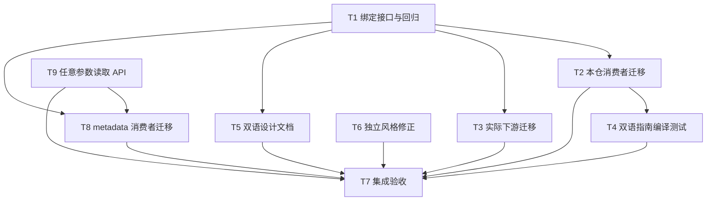

# rs-validator 参数绑定契约与文档验证实施计划

> 历史实施计划：复选框保留写作时状态，不代表当前待办；当前事实以源码、测试和双语当前设计文档为准。

> 本计划对应[设计文档](design-20261013T114855816Z-4bfe54da.md)。用户已接受评审意见，允许必要的破坏性 API 变更。本计划只安排直接相关的修改；不授权 `git add`、`git commit` 或 `git push`，也不创建新的 Paseo workspace。

**目标仓库：** `/data/working/qubit/rust-common/rs-validator`。使用当前 workspace 中的既有下游目录。每个任务开始前检查相关文件的当前状态，保留其他人的未提交改动。

## 文件映射与统一契约

- `src/binding/prepared_validator.rs`：`PrepareFn` 改为接收 `&mut ArgumentReader<'_>`，Rustdoc 明确谁保证哪些参数错误。
- `src/registry/validator_descriptor.rs`：唯一的绑定参数检查流程，供显式索引和按输入形状选择两个入口复用；`src/registry/validator_registry.rs` 仅在需要显式关联参数切片生命周期时调整签名。
- `tests/registry/validator_descriptor_tests.rs`：工厂忽略参数时的重复、未知参数回归，以及已有工厂 fixture 的新签名；`tests/registry/validator_registry_tests.rs` 覆盖注册表入口的同一保证。
- `src/lib.rs`、`src/registry/{validator_registration,validator_signature}.rs`、`src/binding/bound_validator.rs`：公共 Rustdoc 示例迁移。
- `examples/{local_registry,validate_named_bench}.rs`、使用 `ValidatorSignature::new` 的现有 `tests/**/*.rs`、`README.md`、`README.zh_CN.md`：工厂调用签名迁移；保持示例可执行。
- `rs-validation-rules/src/registry/{collection,decimal,regex,text,time}.rs`：真实下游工厂迁移。
- `doc/user_guide.md`、`doc/user_guide.zh_CN.md`、`tests/documentation_examples_tests.rs`：两版基础指南的组合编译验证，并迁移指南里的工厂代码。
- `doc/design.md`、`doc/design.zh_CN.md`：准确描述自动参数检查与 `trusted_source()` 的数据保留边界。
- `src/binding/bound_validation_context.rs`：移除五处返回 `Result` 方法上的冗余 `#[must_use]`；`src/binding/bound_validator.rs` 的同类修正在该文件的文档迁移任务中完成。

绑定成功的统一条件是：描述符有效、签名选中、`ArgumentReader::new` 通过、工厂返回成功、`reader.finish()` 通过、预备形状匹配。工厂报错优先于未消费参数，未消费参数优先于预备形状错配。错误路径保留原 `BindErrorKind`，并附带已选规则 ID。必填参数由工厂使用 `required_*` 声明；框架不推测未声明的必填项。

## 调度图

| 任务 | 前置任务 | 最小解锁产物 | 写入集合 | 本地验证 | 集成验证归属 | 审查时机 |
| --- | --- | --- | --- | --- | --- | --- |
| T1 绑定接口与回归 | 无 | 新 `PrepareFn` 与共享绑定检查 helper 可编译 | `src/binding/prepared_validator.rs`、`src/registry/validator_descriptor.rs`、`src/registry/validator_registry.rs`、`tests/registry/validator_descriptor_tests.rs` | `cargo check --lib --locked`；定向契约测试 | T7；Cargo 资源组 A | 立即审查 |
| T2 本仓消费者迁移 | T1 | 本仓示例、测试与 README 适配新工厂签名 | 下文 T2 精确文件集合 | `cargo check --all-targets --locked`；README 示例测试 | T7；资源组 A | 立即审查 |
| T3 实际下游迁移 | T1 | `rs-validation-rules` 的五个注册模块适配新接口 | `../rs-validation-rules/src/registry/{collection,decimal,regex,text,time}.rs` | `cargo check --locked --all-features`，工作目录为 `../rs-validation-rules` | T7；资源组 A | 批量审查；可与 T2、T5、T6、T8 并行 |
| T4 双语指南编译测试 | T2 | 两版基础路径可分别从文档组合编译 | `doc/user_guide.md`、`doc/user_guide.zh_CN.md`、`tests/documentation_examples_tests.rs` | 文档测试过滤运行 | T7；资源组 A | 立即审查 |
| T5 双语设计文档 | T1 | 参数与脱敏边界的准确双语说明 | `doc/design.md`、`doc/design.zh_CN.md` | 文案与 API 对照、链接核对 | T7 | 批量审查；可与 T2、T3、T6 并行 |
| T6 独立风格修正 | 无 | 五处冗余属性清除 | `src/binding/bound_validation_context.rs` | `cargo check --lib --locked` | T7；资源组 A | 批量审查；可与 T1、T5 并行 |
| T8 metadata 消费者迁移 | T1、T9 | 两个 metadata 仓库的测试与运行时 fixture 使用 reader 工厂签名 | 下文 T8 精确文件集合 | 两仓 validation feature 检查 | T7；资源组 A | 批量审查；与 T3 独立 |
| T9 任意参数读取 API | 无 | `ArgumentReader::required_argument` 能按名称消费并返回任意 `ValidationArgument` | `src/binding/argument_reader.rs`、`tests/binding/argument_reader_tests.rs` | 定向 reader 测试、library check | T8、T7 | 立即审查 |
| T7 集成验收 | T2、T3、T4、T5、T6、T8、T9 | 全部改动齐备 | 无计划内源码写入 | 下文完整门禁 | 本任务独占全量验证；资源组 A 命令串行 | 立即审查 |

资源组 A 指共享 Cargo 缓存与当前机器 I/O；表中重型命令不要同时运行。并行批次按文件写入集合互斥安排，T1 是 T2、T3、T5 的接口前置。

## 任务拓扑依赖图



## T1：绑定接口与回归

**文件：** `src/binding/prepared_validator.rs`、`src/registry/validator_descriptor.rs`、`tests/registry/validator_descriptor_tests.rs`。

- [ ] 在描述符测试中先写 `test_bind_rejects_duplicate_parameter_even_when_factory_ignores_reader`、`test_bind_rejects_unconsumed_parameter`、`test_bind_for_rejects_unconsumed_parameter`、`test_bind_reports_missing_required_parameter` 四个定向用例：分别断言 `DuplicateParameter`、`UnknownParameter`、`UnknownParameter`、`MissingParameter`，且 `rule_id()` 是所绑定 ID。沿用当前文件的 `PreparedValidator` fixture；新测试工厂签名为 `fn prepare(reader: &mut ArgumentReader<'_>) -> Result<Arc<dyn PreparedValidator>, BindError>`，忽略参数用例显式写 `_reader`，必填用例调用 `reader.required_u32("maximum")?`。
- [ ] 运行 `cargo test --locked test_bind_rejects_unconsumed_parameter`，确认新断言先因旧接口或当前静默接受行为失败；保留实际失败信息。
- [ ] 在 `prepared_validator.rs` 把公开类型别名改为：

  ```rust
  pub type PrepareFn = for<'a> fn(&mut ArgumentReader<'a>)
      -> Result<Arc<dyn PreparedValidator>, BindError>;
  ```

  改同文件 Rustdoc：重复名由绑定层创建 reader 时拒绝；未消费参数由绑定层结束 reader 时拒绝；必填、类型、范围由工厂的读取方法判断。工厂被直接调用时不提供绑定层保证。把旧切片工厂 doctest 改成 reader 工厂。
- [ ] 在 `validator_descriptor.rs` 建一个私有 `prepare_checked` helper：创建 reader、调用工厂、调用 `finish()`、检查预备形状，全部错误经 `with_rule(rule_id)` 标注；`bind` 和 `bind_for_validated` 都调用它。让读入参数切片与 reader 的生命周期一致，必要时在本任务拥有的 `validator_registry.rs` 中为 `ValidatorRegistry::bind` 显式标注参数生命周期；外部仍传原来的参数切片。保持描述符与签名选择在创建 reader 前进行。
- [ ] 迁移本测试文件原有工厂 fixture 到 reader 签名，运行新增用例与 `cargo check --lib --locked`。此时其他测试和示例尚待 T2 迁移，不能把它们的暂时编译错误当作 T1 失败。

## T2：迁移本仓消费者和 README

**精确写入集合：** `src/lib.rs`、`src/binding/bound_validator.rs`、`src/registry/validator_registration.rs`、`src/registry/validator_signature.rs`、`examples/local_registry.rs`、`examples/validate_named_bench.rs`、`README.md`、`README.zh_CN.md`，以及以下测试文件：

```text
tests/binding/bound_validator_tests.rs
tests/binding/contextual_adapter_tests.rs
tests/binding/dependency_binding_tests.rs
tests/binding/domain_rule_adapter_tests.rs
tests/binding/typed_adapter_tests.rs
tests/inventory_error_tests.rs
tests/protocol/cross_layer_contract_tests.rs
tests/protocol/stable_identifier_tests.rs
tests/registry/inventory_registration_tests.rs
tests/registry/validator_registration_tests.rs
tests/registry/validator_registry_tests.rs
tests/security/formatting_tests.rs
```

- [ ] 用 `rg -n 'fn prepare|ArgumentReader::new|ValidatorSignature::new'` 对照上述文件，迁移所有被 `ValidatorSignature::new` 引用的工厂为 `&mut ArgumentReader<'_>`。无参工厂不读取；有参工厂直接调用 `reader.optional_*` 或 `reader.required_*`。移除这些工厂内部的 `ArgumentReader::new(args)?` 与 `reader.finish()?`，保留独立演示 reader 用法的代码和测试。在 `tests/registry/validator_registry_tests.rs` 增加一个对忽略 reader 的工厂传未知参数的用例，断言 `ValidatorRegistry::bind` 返回 `UnknownParameter` 且带规则 ID。
- [ ] 更新 `src/lib.rs`、三个核心类型 Rustdoc、两个 `examples/` 和双语 README 中的完整工厂代码。README 的无参示例只接收 `_reader`；保留原用户注册路径、代码和存储断言。`src/binding/bound_validator.rs` 同时移除 `try_from_prepared` 返回 `Result` 之上的冗余函数级 `#[must_use]`，不改变函数签名。
- [ ] 运行 `cargo check --all-targets --locked`，随后运行 `cargo test --locked test_readme_quick_start_programs_run`。预期所有本仓 target 编译，英文和中文 README 程序均运行成功；若筛选命令未选中测试，以 `cargo test --locked -- --list` 核对目标名称后改用实际过滤名。
- [ ] 再次搜索本仓 `fn prepare...(&[NamedValidationArgument` 与 `ValidatorSignature::new`，确认没有旧签名的工厂或 Rustdoc 示例。单独的 `ArgumentReader::new` 测试与 `PreparedValidator` 直接调用示例不应误改。

## T3：迁移实际下游

**文件：** `/data/working/qubit/rust-common/rs-validation-rules/src/registry/{collection,decimal,regex,text,time}.rs` 与 `tests/local_registry_tests.rs` 中直接调用签名工厂的 fixture。

- [ ] 将这五个文件中供 `ValidatorSignature::new` 使用的 `prepare_*` 改为接受 `&mut ArgumentReader<'_>`。把 `no_args` helper 改为接受 reader 且不调用 `finish()`；无参规则直接不消费参数，绑定层统一检查多余输入。有参规则沿用原有读取顺序和领域约束，移除重复创建 reader 与局部 `finish()`。
- [ ] 同步这些函数的 Rustdoc 参数说明和错误说明：工厂负责读取与领域约束；重复和未知参数在外层绑定流程报告。移除不再需要的 `NamedValidationArgument` import；只处理编译器实际指出的相关 import。
- [ ] 把 `tests/local_registry_tests.rs` 中直接调用 `signature.prepare()` 的测试迁移为先创建 `ArgumentReader` 再传 `&mut reader`；独立直接调用不负责 `finish()`。运行 `cargo check --locked --all-features`，再运行 `cargo test --locked --test local_registry_tests test_standard_rules_are_available_to_local_registries_without_inventory` 与 `cargo test --locked test_invalid_rule_parameters_are_rejected_during_binding`。前者覆盖有参规则，后者已覆盖无参规则收到额外参数时的 `UnknownParameter`。不要修改 `rs-model-metadata` 的生产行为；其工厂 fixture 迁移由 T8 完成。

## T4：双语用户指南基础路径的组合编译

**文件：** `doc/user_guide.md`、`doc/user_guide.zh_CN.md`、`tests/documentation_examples_tests.rs`。

- [ ] 把两版指南基础路径 `rules.rs` 中的工厂改为 reader 参数，不再在工厂内部构造 reader或手动 `finish()`；解释多余参数由绑定层在工厂成功后拒绝。保持 `startup.rs`、`service.rs` 和后续保存决策的业务语义一致。
- [ ] 在两版指南的 `rules.rs`、`startup.rs`、`service.rs`、接续 `service.rs` 四段 fenced Rust 代码块前，分别加入一次稳定标记：`<!-- validator-guide:rules -->`、`<!-- validator-guide:startup -->`、`<!-- validator-guide:service -->`、`<!-- validator-guide:service-continuation -->`。不移动进阶代码块。
- [ ] 扩展文档测试，分别提取四个标记之后的 Rust fenced block；缺失、重复、错误语言或未关闭 fence 均失败。两版各创建独立 `TemporaryApp`，用 `guide_en`、`guide_zh` 作安全目录名。写 `rules.rs`、`startup.rs`，把两段 service 内容按原顺序拼成 `service.rs`；生成最小 `src/profile/mod.rs`（声明三个子模块）和 `src/main.rs`（声明 `mod profile; fn main() {}`）。临时 manifest 用本仓路径依赖；在应用目录运行 `cargo check --offline --quiet`，失败信息必须包含文档名与 stderr。
- [ ] 用独立的提取函数负向测试验证标记缺失与重复；运行 `cargo test --locked test_user_guide_basic_path_compiles`，预期英文和中文基础路径分别完成组合编译。保留现有 README 运行测试，避免新逻辑掩盖它。

## T5：修订双语设计文档

**文件：** `doc/design.md`、`doc/design.zh_CN.md`。

- [ ] 在“参数的一次性消费”及数据流段写明：描述符绑定创建 reader，重复名先被拒绝，工厂读取规则认识的参数，成功后绑定层检查未消费参数；必填与取值约束仍归工厂。删除把所有参数错误无条件归于任意 `PrepareFn` 的措辞。
- [ ] 在两版的目标与脱敏段把“执行错误不保留被拒绝输入”改为可验证的边界：报告与普通错误格式化不自动暴露原始输入；`with_trusted_source` 可保留任意拥有型原因，`trusted_source()` 显式提供给可信调用者，使用方负责不把敏感原因传播至日志或客户端。保留对 `ViolationParam` 来源责任的说明。
- [ ] 核对两版段落含义与 `ExecutionError` Rustdoc、既有敏感原因测试一致；不改 `ExecutionError` 实现，也不增加与现有测试重复的测试。

## T6：独立风格修正

**文件：** `src/binding/bound_validation_context.rs`。

- [ ] 移除 `value`、`dependency_path`、`typed`、`optional_typed`、`text` 方法上重复于返回 `Result` 的函数级 `#[must_use]`，保留返回类型、`#[inline]` 与 Rustdoc 语义。
- [ ] 运行 `cargo check --lib --locked`，确认只产生属性删除。无需为纯属性清理新增行为测试。

## T8：迁移 metadata 消费者工厂

**文件：** `rs-model-metadata` 与 `rs-model-metadata-v3` 中搜索确认的 `ValidatorSignature::new` 测试及运行时 fixture：

```text
rs-model-metadata/derive/tests/runtime-fixtures/linked-workspace/model-b/src/models.rs
rs-model-metadata/tests/model_validation_tests.rs
rs-model-metadata/tests/validation/{execution_policy_tests,declaration_binding_tests,validator_arguments_tests}.rs
rs-model-metadata/tests/validation_binding_tests.rs
rs-model-metadata-v3/derive/tests/runtime-fixtures/linked-workspace/model-b/src/models.rs
rs-model-metadata-v3/tests/model_validation_tests.rs
rs-model-metadata-v3/tests/validation/{execution_policy_tests,declaration_binding_tests,validator_arguments_tests}.rs
rs-model-metadata-v3/tests/validation_binding_tests.rs
```

- [ ] 将上述签名声明中传给 `ValidatorSignature::new` 的工厂改为接受 `&mut ArgumentReader<'_>`；工厂读取参数时复用传入的 reader，移除重复构造与 `finish()`。不要改动同文件其他工作树变更或无关逻辑。
- [ ] 分别在两个仓库运行 `cargo check --locked --features validation`。
- [ ] 提交只包含本次工厂迁移的变更；原工作树中的既有未提交内容必须原样保留。

## T9：支持任意类型的具名参数读取

**文件：** `src/binding/argument_reader.rs`、`tests/binding/argument_reader_tests.rs`。

- [ ] 先新增一个行为测试，断言 `required_argument(name)` 返回原始 `ValidationArgument` 且将该参数标记为已消费，随后 `finish()` 成功；用缺失名称断言 `MissingParameter`，并验证第二次读取同名参数为 `ParameterAlreadyConsumed`。先运行并确认因方法不存在而失败。
- [ ] 新增公开方法 `required_argument(&mut self, name: &str) -> Result<ValidationArgument<'a>, BindError>`，复用内部一次性 `take`，Rustdoc 说明调用方负责对返回枚举作类型与领域检查。
- [ ] 运行定向测试及 `cargo check --lib --locked`；只提交这两个文件。

## T7：集成验收与范围复核

**写入集合：** 无。所有命令在当前 workspace 中顺序运行，避免共享 Cargo 缓存和 I/O 争用。

- [ ] 在 `rs-validator` 运行 `cargo test --locked`、`cargo test --all-features --locked`。确认新参数契约、两版 README、两版指南以及 doctest 全通过。
- [ ] 运行 `cargo clippy --all-features --all-targets --locked -- -D warnings`、`cargo check --workspace --all-targets --locked`，以及项目 `.infra/bin/style-check.sh`。在只读核对其实际脚本行为后再执行任何会写盘的格式工具；风格检查发现只修正本计划涉及文件。
- [ ] 在 `rs-validation-rules` 顺序运行 `cargo test --locked` 与 `cargo test --all-features --locked`；在 `rs-model-metadata` 和 `rs-model-metadata-v3` 顺序运行 `cargo check --locked --features validation`，确认 T8 迁移可编译。若某仓缺对应 feature 或已有不相关构建故障，记录原始输出与未验证范围，不把它写成 rs-validator 回归。
- [ ] 检查所有 `ValidatorSignature::new` 工厂签名、`PrepareFn` Rustdoc、中英文 README、指南、设计文档、相对链接和本地标题锚点；核对目标文件中的示例代码与当前 API 一致。运行 `git diff --check`、`git diff --stat`、`git status --short`，逐仓确认仅有本计划授权的路径变化。
- [ ] 报告实际验证命令、退出码、仍有的限制和破坏性迁移范围。除非用户另行明确授权，不执行 `git add`、`git commit` 或 `git push`。
